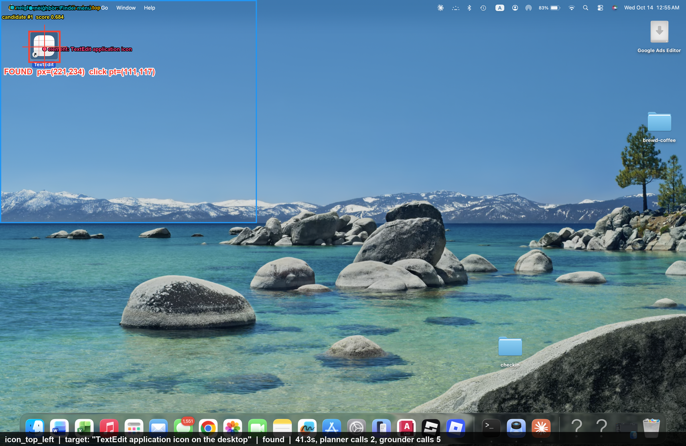
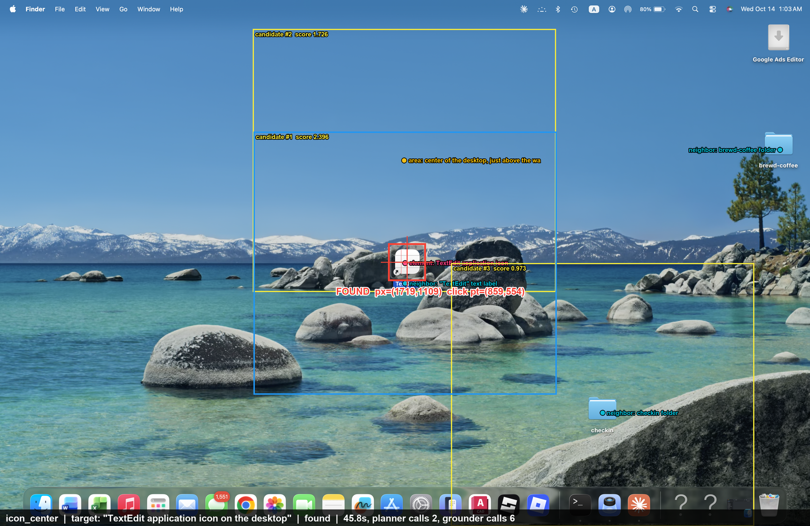
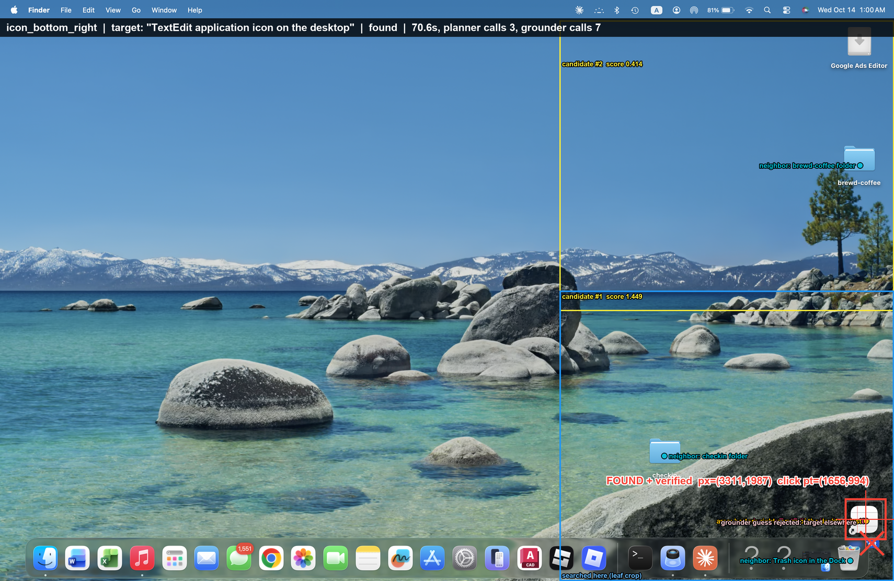

# tjm-visual-agent

Vision-based desktop automation built around a from-scratch implementation of
**ScreenSeekeR** (Li et al., *ScreenSpot-Pro: GUI Grounding for Professional High-Resolution
Computer Use*, 2025, §4.2 / Algorithm 1 / Appendix C).

From a screenshot alone, the agent finds a desktop icon described in plain language,
double-clicks it, and writes the first ten [JSONPlaceholder](https://jsonplaceholder.typicode.com/posts)
posts to `~/Desktop/tjm-project/post_{id}.txt` through the editor's UI. Before every launch it
takes a new screenshot and runs a new search, so it never reuses the icon's last position.

> **Platform:** the brief targets Windows/Notepad. With permission, this runs on **macOS with
> TextEdit**, launched from a TextEdit alias on the desktop. See [docs/design.md §2](docs/design.md)
> for the full mapping and every deviation.

- **Design (Part 1):** [docs/design.md](docs/design.md)
- **Measured results and failure analysis:** [docs/evaluation.md](docs/evaluation.md)
- **Evidence:** [evidence/](evidence/) has real annotated detections plus a manifest of
  model, config and timings.

| Top-left | Center | Bottom-right |
|---|---|---|
|  |  |  |

## How grounding works

```
screenshot + "TextEdit application icon on the desktop"
   │
   ├─ Planner (Claude): paper's position-inference prompt → <element>/<area>/<neighbor> refs
   ├─ Grounder (UI-Venus-1.5-2B, local MLX): each ref → point → voter box
   ├─ dilate → Eq.1 centre-distance scoring (σ=0.3) → NMS → sort
   ├─ recurse into the best crop until it is ≤ 1280 px
   ├─ leaf: grounder predicts the target; planner verifies it with the paper's
   │        result-check prompt (red box) → is_target / target_elsewhere / target_not_found
   └─ found(point) | not_found | budget_exhausted      (uncertainty never becomes a click)
```

The engine (`src/tjm_agent/grounding/`) knows nothing about TextEdit, icons or posts. The same
call finds `"Save" button in the save sheet` or `"OK" button in the alert`. The workflow uses it
that way for unexpected dialogs: Claude first classifies the dialog, a short allowlist of safe
buttons limits what it may press, and ScreenSeekeR then locates the chosen button from its
label.

## Setup

Requirements: macOS on Apple Silicon (MLX), [uv](https://docs.astral.sh/uv/), and an Anthropic
API key.

```bash
uv sync --locked
cp .env.example .env          # then set ANTHROPIC_API_KEY=...
```

The first grounding call downloads the grounder (`mlx-community/UI-Venus-1.5-2B-6bit`, ~2.5 GB)
to the Hugging Face cache.

**macOS permissions.** Grant both of these to the terminal app that runs the agent, under
System Settings › Privacy & Security:
- **Screen Recording** to take screenshots
- **Accessibility** to send mouse and keyboard events and read the focused field during save

**Desktop.** You need an alias to TextEdit on the desktop (in Finder, ⌥⌘-drag
`/System/Applications/TextEdit.app` onto the desktop). Turn off View › Use Stacks and set
View › Sort By › None, so the icon stays where it is dropped. Quit TextEdit before a run.

## Run

```bash
uv run --locked tjm-agent doctor                     # permissions, display mapping, config
uv run --locked tjm-agent ground                     # find the TextEdit alias, save annotated trace, no click
uv run --locked tjm-agent ground --target "Blender application icon on the desktop"   # absent → not_found
uv run --locked tjm-agent run --posts 10             # the assignment
```

Each run writes raw screenshots, annotated traces (`*_annotated.png`), per-search JSON and a
`summary.json` to `artifacts/run-*/`. That folder is git-ignored.

Optional settings in `.env`: `PLANNER_MODEL` (default `claude-opus-5-5`), `PLANNER_EFFORT`
(default `low`), `GROUNDER_REPO`, `OUTPUT_DIR`.

## Safety behaviour

- It refuses to start if TextEdit is already running, so it never touches documents it didn't
  create.
- It refuses to overwrite existing `post_*.txt` files.
- It sets TextEdit's preferences for the run only, then restores your previous values:
  plain text, no smart quotes or dashes, no auto-capitalisation or autocorrect, no window
  restoration.
- It sends no keyboard shortcuts to uncover the desktop. Apps are hidden through `NSRunningApplication`,
  and Finder windows are minimised through Accessibility.
- It won't click if a window appeared between the screenshot and the click, and it re-grounds
  instead.
- It reads each text field back through Accessibility before pressing Return.
- Unexpected dialogs can only be dismissed with an allowlisted safe button. A destructive,
  permission or unclear dialog stops the run.
- `pyautogui` failsafe is on: move the mouse into a screen corner to abort.

## Tests

```bash
uv run --locked pytest           # unit tests (no models, no desktop)
uv run --locked ruff check .
```

The unit tests cover the geometry (Eq. 1, dilation, NMS, coordinate mapping), parsing of
planner and grounder output, the search's control flow (found, pruned, abstain, rewrite-and-retry,
budget exhaustion) using scripted fake models, post validation and saved-file verification. CI
runs these on every push. **A green CI badge does not mean the live desktop run passed.** Live
results are reported separately in [docs/evaluation.md](docs/evaluation.md).

## Layout

```
src/tjm_agent/
  grounding/screenseeker.py   Algorithm 1: plan → ground → dilate → score → NMS → recurse → verify
  grounding/backends.py       Claude planner, UI-Venus grounder (only module importing model SDKs)
  grounding/prompts.py        Appendix C prompts (verbatim) + grounder prompt + dialog triage
  geometry.py                 boxes, Eq.1, NMS, 0–1000 → pixels → points
  desktop.py                  screenshots, Quartz input, window and focus state
  workflow.py                 ten-post state machine and bounded recovery
  posts.py / verification.py  API data and byte-exact checks of what the UI saved
  trace.py / cli.py           annotated traces; doctor | ground | run
scripts/demo_desktop.py       temporarily stash and restore Desktop items for a clean demo
```
